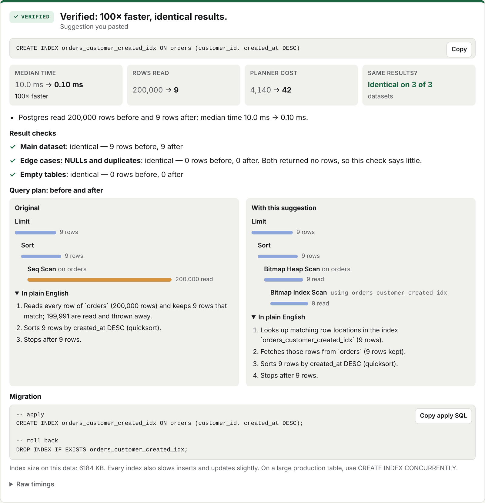
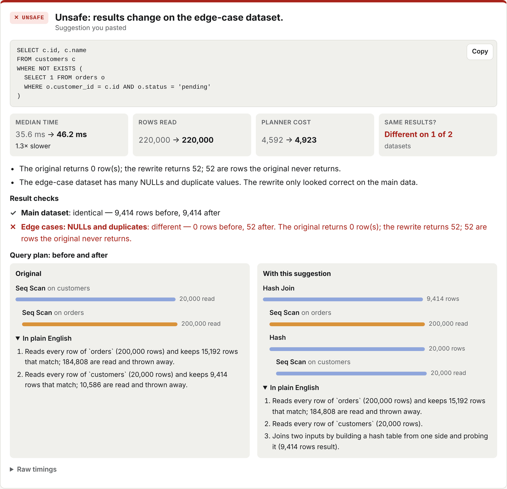
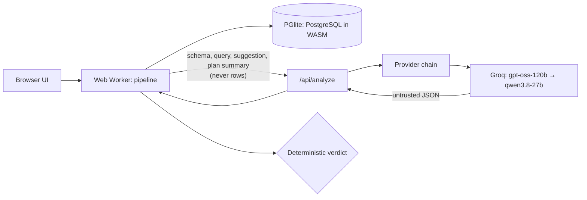

# PlanProof

**AI proposes. PostgreSQL proves.**

AI assistants suggest SQL indexes and rewrites all the time. Before shipping one, you need to know two
things: does it actually make the query faster, and does it still return the same rows?
PlanProof answers both by running it.

Paste your schema, the slow query and what your AI suggested. PlanProof loads them into a real
PostgreSQL running **inside your browser tab**, measures the original and the suggestion, compares the
results on your data, on a hostile edge-case dataset and on empty tables, and gives a verdict with the
evidence.

**Live demo: [planproof-two.vercel.app](https://planproof-two.vercel.app/)** · [Architecture](docs/ARCHITECTURE.md) · [Evaluation results](docs/benchmarks/RESULTS.md) · [Security](SECURITY.md)



## Verified in production

Checked on the live deployment on 11 November 2026 (details in [docs/DEPLOYMENT.md](docs/DEPLOYMENT.md#production-verification)):

- The one-click demo and all four built-in examples return their documented verdicts.
- AI analysis runs through Groq (`openai/gpt-oss-120b`); its answers are verified like any other suggestion.
- Cancelling a run, invalid input and a runaway query are handled; the page recovers afterwards.
- Security headers are present, the API key is not in any page or script the browser loads, and the AI endpoint
  rejects malformed, oversized and excessive requests.

## Verdicts

| Verdict | Meaning |
|---|---|
| **VERIFIED** | Identical results on every dataset tested, a different plan, and at least 1.5× faster with lower planner cost or fewer rows read |
| **INEFFECTIVE** | Identical results, but no meaningful gain, or Postgres did not use the index |
| **UNSAFE** | The results change on at least one dataset, or the SQL tries to modify data (it is blocked, never run) |
| **INVALID** | The SQL could not be run |

An AI model can explain the plan, pull SQL out of a pasted chat answer and propose its own fix.
**It never decides a verdict.** Everything it produces goes through the same checks as anything you paste.

## Why it is needed

These suggestions look reasonable and pass code review, and PlanProof's built-in examples show each of them going wrong:

- *"Index the column you filter on."* If the filter matches most of the table, Postgres ignores the index.
  **INEFFECTIVE**, decided from the plan, not from timings.
- *"Rewrite the `IN` subquery as a `JOIN`, it's faster."* The JOIN returns a customer once per matching order.
  **UNSAFE**: duplicates detected by multiset comparison.
- *"`NOT IN` is bad, use `NOT EXISTS`."* Identical on normal data, but if the subquery contains a NULL,
  `NOT IN` returns nothing and `NOT EXISTS` doesn't. **UNSAFE**, caught only by the edge-case dataset.
- *"Add a composite index."* Here it reads 9 rows instead of 200,000 and keeps every result identical. **VERIFIED**.



## How verification works

1. **Load.** The schema and your seed data, or realistic generated data, go into PGlite (PostgreSQL compiled
   to WebAssembly) in a Web Worker. Generated data respects foreign keys and mixes in the string literals from your query.
2. **Measure.** `EXPLAIN (ANALYZE, FORMAT JSON)`: one warm-up then the median of up to five runs.
   PlanProof records time, planner cost, rows read and plan shape.
3. **Try each candidate safely.** Indexes are created in a transaction that is always rolled back; rewrites run in
   `READ ONLY` transactions. Destructive SQL is refused before it reaches the database.
4. **Compare results** row by row, as a multiset (and in order when the query has `ORDER BY`), on three datasets:
   your data, an edge-case dataset (many NULLs and duplicates) and empty tables.
5. **Decide** with a deterministic rule ([details](docs/ARCHITECTURE.md#verification-engine-srclibharness)).
   Structural checks (was the index used, did the plan change) come before timings, because WebAssembly timings vary.

Every result card shows before/after query plans with plain-English steps generated from the plan itself, the
result checks per dataset, and copyable migration and rollback SQL.

## Architecture



Full diagrams, the deterministic/probabilistic boundary and the verdict flow: [docs/ARCHITECTURE.md](docs/ARCHITECTURE.md).

## Evaluation

`npm run eval` runs a fixed set of scenarios several times each on a fresh database and writes
[docs/benchmarks/RESULTS.md](docs/benchmarks/RESULTS.md). Expected verdicts were assigned from SQL semantics before running.

Latest run (2026-11-11, 13 scenarios × 5 runs, PGlite 0.5.16, Node v22.23.4):

- **65 / 65** runs reached the expected verdict; no scenario's verdict varied between runs.
- **5 / 5** result-changing rewrites were flagged UNSAFE in every run, including one that only fails on the NULL-heavy edge dataset and one that only fails on empty tables.
- For the suggestions that genuinely help:

| Scenario | Speed-up min / median / max | Rows read before → after | Planner cost before → after |
|---|---|---|---|
| index-works | 172× / 187× / 208× | 200,000 → 9 | 4,140 → 42 |
| expression-index | 332× / 417× / 1043× | 20,000 → 1 | 464 → 8 |
| partial-index-rare-status | 269× / 318× / 335× | 200,000 → 50 | 4,653 → 22 |

These are PostgreSQL-in-WebAssembly timings on synthetic data on one machine. They show the size of an effect,
not what the same change does on a production server. Methodology is in the results file.

## Testing

**115 automated tests**, all passing, plus a browser smoke test in CI.

| Suite | Tests | Covers |
|---|---|---|
| `tests/ai.test.ts` | 38 | Provider adapter, fallback chain, retries, timeouts, parsing, config, handler, browser client |
| `tests/datagen.test.ts` | 10 | Synthetic data generation edge cases (real PGlite) |
| `tests/equivalence.test.ts` | 10 | Result comparison: duplicates, NULLs, ordering, types |
| `tests/guard.test.ts` | 22 | Lexer and SQL guard |
| `tests/pipeline.test.ts` | 30 | Full verification pipeline on real PGlite: verdicts, destructive SQL, untrusted AI output |
| `tests/watchdog.test.ts` | 5 | Runaway-query watchdog (fake timers) |

```bash
npm test          # unit + integration (real PGlite)
npm run eval      # evaluation scenarios
npm run e2e -- http://localhost:3000 --demo     # browser smoke test (needs Playwright + Chromium)
```

## Run locally

Requires Node.js 20 or later.

```bash
git clone https://github.com/Shash-176/planproof.git
cd planproof
npm install
cp .env.example .env.local   # optional: add GROQ_API_KEY for AI analysis
npm run dev                  # http://localhost:3000
```

Without a key everything works except the AI explanation and AI-proposed fixes.

### Environment variables

| Variable | Required | Purpose |
|---|---|---|
| `GROQ_API_KEY` | For AI analysis | Free key from [console.groq.com](https://console.groq.com/keys). Enables the default chain. |
| `AI_CHAIN` | No | Ordered `provider:model` list. Default `groq:openai/gpt-oss-120b,groq:qwen/qwen3.8-27b` |
| `GEMINI_API_KEY`, `OPENROUTER_API_KEY` | No | Enable those presets in `AI_CHAIN` (see caveats in [AI-PROVIDER.md](docs/AI-PROVIDER.md)) |
| `AI_CUSTOM_BASE_URL`, `AI_CUSTOM_API_KEY` | No | Any OpenAI-compatible endpoint, e.g. a local Ollama |

## AI provider

Default: **Groq**, `openai/gpt-oss-120b` with strict JSON-schema output, falling back to `qwen/qwen3.8-27b` on the
same key (Groq's free-tier limits are per model). Chosen for a free tier usable without a payment method, strict
schema support and terms that suit a public site. The comparison with Gemini, OpenRouter, Cloudflare Workers AI and
others, with sources, is in [docs/AI-PROVIDER.md](docs/AI-PROVIDER.md).

If every model is rate-limited or down, AI analysis is skipped with a message. **Verification never depends on the model.**

## Deploy

The live demo runs on Vercel's free Hobby plan: a static page plus one serverless route, with `GROQ_API_KEY` as
the only secret. To deploy your own copy, see [docs/DEPLOYMENT.md](docs/DEPLOYMENT.md) or use the button.

[](https://vercel.com/new/clone?repository-url=https%3A%2F%2Fgithub.com%2FShash-176%2Fplanproof&env=GROQ_API_KEY&envDescription=Free%20Groq%20API%20key%20for%20optional%20AI%20analysis&envLink=https%3A%2F%2Fconsole.groq.com%2Fkeys)

## Security model

- Your SQL only runs in a throwaway PostgreSQL in your own tab. Destructive statements are refused, rewrites run
  `READ ONLY`, index trials roll back.
- A watchdog stops runaway queries (PGlite ignores `statement_timeout`).
- The page is cross-origin isolated (COOP + COEP), which also gives PostgreSQL's timings a microsecond clock.
- The AI key stays on the server. `/api/analyze` checks the origin, limits body size and request rate, and validates
  input and output.
- Rows never leave the browser. With AI analysis on, the schema, query, pasted suggestion and a plan summary are sent
  to the AI provider. The page says so next to the toggle.

Details and known limitations: [SECURITY.md](SECURITY.md).

## Limitations

- WebAssembly timings and synthetic data are not production. Confirm on your own database before shipping.
- When the optimised query is faster than the browser's clock can measure, the speed-up is shown as a minimum
  ("at least N×") rather than an exact ratio.
- Synthetic data is uniformly distributed; real data is skewed, which can change the planner's choices.
- Identical results on three datasets is strong evidence, not a proof of equivalence.
- One read-only query at a time. Write cost of indexes is reported as size only.
- If the original `ORDER BY` has ties, a correct rewrite can be reported as a different order.

## Tech stack

TypeScript · Next.js 16 · React 19 · PGlite (PostgreSQL 18 in WebAssembly) · Zod · Vitest · Playwright (smoke script) ·
ESLint · GitHub Actions · Vercel

## Roadmap

- Import real table statistics (`pg_stats`) or a data sample to make plans match production more closely
- Test combinations (index plus rewrite)
- A CLI and GitHub Action that check SQL changes in pull requests
- Shareable result links

## Project history

PlanProof started on 10 November 2026 as an entry to the BharatCode Build League hackathon. The planning documents
from that time are in [docs/history](docs/history/).

## Licence

[MIT](LICENSE)
