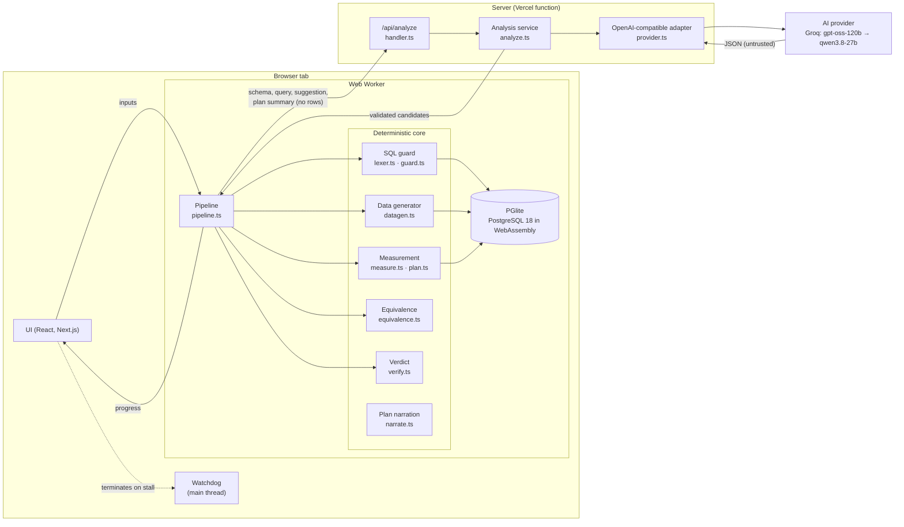
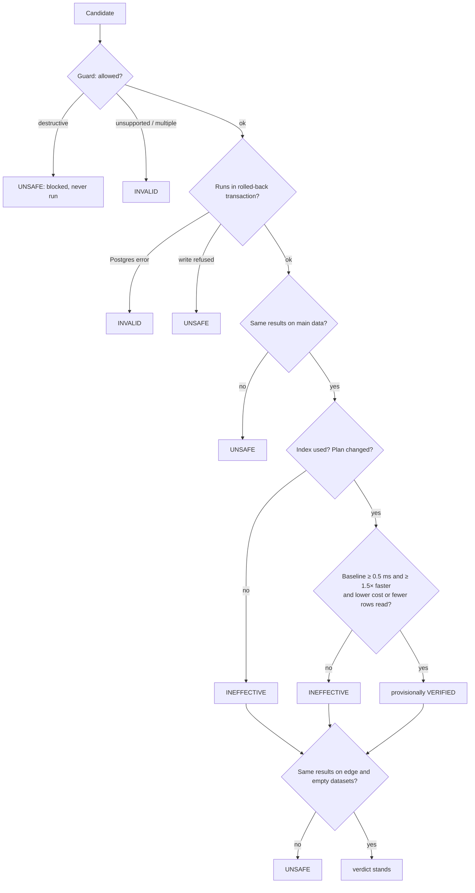

# Architecture

PlanProof checks a proposed SQL optimisation by running it. The one idea that shapes everything:

> **The model proposes. PostgreSQL proves.**
> Anything probabilistic may suggest or explain. Only deterministic execution may decide.

## System overview

### The deterministic / probabilistic boundary

| Probabilistic (may be wrong) | Deterministic (decides) |
|---|---|
| Plain-English *why* explanation | Plan narration from the EXPLAIN tree (`narrate.ts`) |
| Extracting SQL from a prose answer | Extracting SQL from code blocks (`candidates.ts`) |
| Proposing candidate indexes and rewrites | Whether a candidate is allowed to run (`guard.ts` + READ ONLY transactions) |
| — | Timings, rows read, planner cost (`measure.ts`) |
| — | Whether results are identical (`equivalence.ts`) |
| — | The verdict (`verify.ts`) |

Model output crosses the boundary in exactly one place: `pipeline.ts` turns validated AI candidates
into `Candidate` objects with `source: 'ai-extracted' | 'ai-proposed'`. From there they go through
the same guard, execution and comparison as anything the user pasted. The model's `rationale` is
displayed, labelled "not evidence", and never read by any decision code.

## Components

### Client

- **`src/app/page.tsx`**: landing page, examples, the form for testing your own SQL, and results.
- **`src/app/useVerifier.ts`**: starts a Web Worker per run, relays progress, and owns the watchdog.
- **`src/lib/watchdog.ts`**: PGlite runs in one WebAssembly thread and ignores `statement_timeout`,
  so a runaway query cannot be cancelled from inside. The watchdog times each database step (default
  45 s) and terminates the worker if it stalls. AI calls are not timed by it.
- **`src/worker/pipeline.worker.ts`**: hosts PGlite and the pipeline, so the page stays responsive.

### Server / API layer

- **`GET /api/analyze`** reports whether AI analysis is configured and which models, without secrets.
- **`POST /api/analyze`** (`src/lib/ai/handler.ts`): same-origin check, body size limit (64 KB), Zod
  validation, per-client and per-instance rate limits, then the analysis service. Errors are mapped
  to fixed codes; internal error text is never returned.

### AI provider abstraction

- **`provider.ts`**: `ChatProvider` interface and one adapter for OpenAI-compatible chat completions.
- **`config.ts`**: provider presets and the fallback chain from environment variables.
- **`analyze.ts`**: prompt, chain walk (retries, `Retry-After`, deadline), parsing and Zod validation.
- **`client.ts`**: the browser re-validates the server's response before it enters the pipeline.

See [AI-PROVIDER.md](AI-PROVIDER.md) for the provider choice and its free-tier constraints.

### Verification engine (`src/lib/harness/`)

The pipeline, in order:

1. **Inputs are classified** (`guard.ts`). The original must be one read-only `SELECT`/`WITH`.
   Schema scripts may only contain DDL; seed scripts only `INSERT`/`SELECT`/`COPY FROM STDIN`.
2. **Database setup.** Schema → seed script, or **generated data** (`datagen.ts`): tables are read
   back from the catalog (so PlanProof never parses DDL), ordered by foreign keys, and filled with
   `INSERT … SELECT generate_series` inside Postgres, seeded with `setseed()` for reproducibility.
   String literals from the query and suggestions are mixed into text columns so filters such as
   `status = 'pending'` match rows. Then `ANALYZE`.
3. **Baseline.** `EXPLAIN (ANALYZE, FORMAT JSON)`: one warm-up plus up to five timed runs, inside
   `BEGIN READ ONLY … ROLLBACK`. The result set is captured for comparison.
   PGlite's timings come from the browser's `performance.now()`, which browsers coarsen to 0.1 ms unless the page
   is cross-origin isolated. PlanProof sends COOP + COEP headers so the page is isolated (microsecond clock), and
   also measures the clock's step at run time (`timer.ts`): an optimised median at or below that step is reported
   as "≤ step" and its speed-up as a lower bound, never as an exact or infinite ratio.
4. **Candidates.** SQL statements in the paste (code blocks first) are extracted deterministically.
   The AI is asked to extract SQL only if the paste contains none, and may add up to two proposals.
5. **Trial per candidate** (`verify.ts`):
   - *index*: `BEGIN; CREATE INDEX …; ANALYZE <table>; SET TRANSACTION READ ONLY;` measure, fetch
     results, record index size, `ROLLBACK`. The index never persists.
   - *rewrite*: `BEGIN READ ONLY;` measure, fetch, `ROLLBACK`. A data-modifying CTE is refused by
     Postgres itself.
6. **Equivalence** (`equivalence.ts`) on three datasets:
   - **main**: the seed or generated data
   - **edge**: a small, hostile dataset: 40% NULLs in nullable columns, a few distinct values per
     text column, query literals mixed in
   - **empty**: all tables truncated

   Rows are canonicalised with type awareness (numeric scale normalised only for `numeric` columns,
   floats rounded to 12 significant digits, dates in ISO form, JSON with sorted keys) and compared as
   a multiset; also in order when the original has a top-level `ORDER BY`.
7. **Verdict** (`verify.ts`):

The structural checks (index used, plan shape unchanged) are decided from the plan, not from timings,
because WebAssembly timings vary by about 15% between runs.

## Data flow and privacy

| Data | Leaves the browser? |
|---|---|
| Rows (seeded or generated) | **Never** |
| Schema, query, pasted suggestion, plan summary | Only if AI analysis is on: sent to `/api/analyze` and on to the configured provider |
| API keys | Never reach the browser; server environment only |

## Technology

| Layer | Choice | Why |
|---|---|---|
| Language | TypeScript (strict) | One language for worker, UI and server |
| App | Next.js 16 (App Router) | Static page plus one serverless route |
| Database | `@electric-sql/pglite` | Real PostgreSQL planner with no server |
| Validation | Zod 4 | Request, model output, and response validation |
| Tests | Vitest against real PGlite; Playwright smoke script | The engine is tested on the real database engine |
| Hosting | Vercel Hobby (live at https://planproof-two.vercel.app/) | Native Next.js; free; environment variables for secrets |

No database server, no auth, no queue, no vector store. None of them would serve a requirement.

## Scaling limits

- **Dataset size** is bounded by browser memory: generated data defaults to 10k rows per parent table and
  up to 100k per child table. Result sets above 200k rows are not compared.
- **AI capacity** is bounded by the provider's free tier (per model: 1,000 requests/day, 8K tokens/minute
  on Groq at the time of writing) and shared by all visitors.
- **Rate limiting** in the API is per serverless instance (in memory). It is a speed bump; the provider's
  quota is the hard cap. A shared store (e.g. Redis) would make it global, at the cost of a new dependency.
